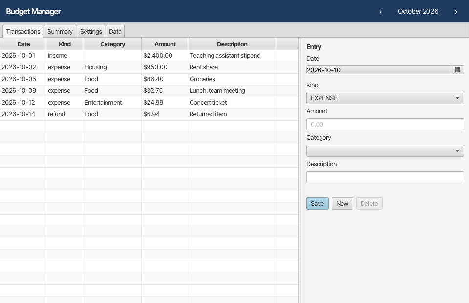
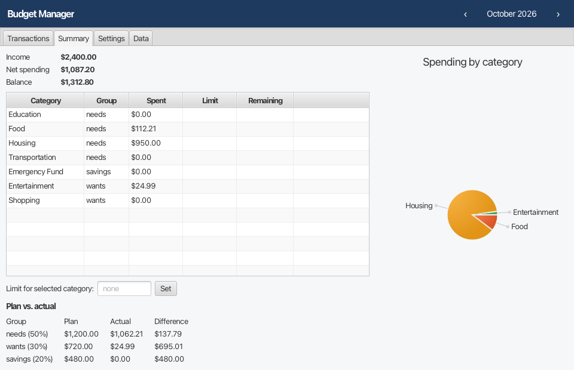

# Budget Manager

A desktop budget manager written in Java 17 and JavaFX. It stores data in SQLite, calculates money exactly, upgrades its schema through versioned migrations, imports CSV files without ever applying half a file, and can back up and restore its database.

This began as a 2023 course project, an in-memory JavaFX app. In October 2026 it was rebuilt from scratch with a layered design and automated tests.




The screenshots are produced by the UI smoke test (`MainWindowTest`) from the real FXML and controller, running on a seeded database.

## Features

- **Transactions:** record expenses, refunds and income, and browse them month by month. The form is validated field by field, and errors are shown next to the field.
- **Summary:** shows income, net spending and balance; spending per category, with optional monthly limits (an exceeded limit shows a negative remainder in red); a pie chart; and a plan-versus-actual table for a needs/wants/savings rule (50/30/20 by default, adjustable).
- **Categories:** add, rename or regroup, delete, and merge. A category that still has transactions cannot be deleted; merge it instead. A merge moves every transaction and limit in a single database transaction.
- **CSV import:** preview first. Every row is checked and errors are reported by file line number. Possible duplicates are flagged. Import is all-or-nothing.
- **CSV export:** RFC 4180 output. Commas, quotes and line breaks in a description survive a full export/import round trip.
- **Backup / restore:** a backup is a consistent copy of the live database (`VACUUM INTO`). Before restoring, the file is checked with an integrity check, the required tables and the schema version. A damaged or foreign file is refused, and the live data stays untouched.

## Architecture

```
ui/            JavaFX: main.fxml + MainController (no SQL, no arithmetic), TransactionForm (pure validation)
  │
service/       LedgerService, SummaryService, CsvService (+ CsvCodec), BackupService
  │            use cases; every multi-step change runs inside one database transaction
persistence/   Database (connection, PRAGMAs, inTransaction), Migrations, *Repository (JDBC)
  │
domain/        Money, Transaction, Category, Kind, Group, AllocationRule — immutable records, no I/O
```

Dependencies point downward only. The domain layer has no JavaFX or JDBC imports, so it is tested without either. The UI calls services and never touches SQL.

## Design decisions

| Decision | Why | Trade-off |
|---|---|---|
| Money is a `long` count of cents (`Money`). `Math.addExact` is used, and percentages use `BigDecimal` with HALF_UP rounding. | `double` cannot represent 0.10. Overflow fails loudly instead of wrapping. | Only one currency, two decimals. |
| The needs/wants/savings split uses the largest-remainder method. | The three parts always add up to the income exactly, to the cent. | Slightly more code than rounding each part. |
| Plain JDBC instead of an ORM. | Four small tables; every query is visible and testable. | More boilerplate in the repositories. |
| SQLite with `foreign_keys=ON`, WAL and `busy_timeout`. | Single-user desktop app, zero setup, one file to back up. | No concurrent multi-user access. |
| Versioned migrations (`db/migration/V<n>__*.sql`), each in its own transaction with a `schema_version` row. | Existing user data upgrades in place. A failed migration rolls back fully. A database from a newer app version is refused instead of being corrupted. | Hand-written runner (≈100 lines) instead of Flyway, to keep the jar small. |
| Constraints are in the schema as well as in code (`CHECK amount_cents > 0`, income ⇔ no category, `ON DELETE RESTRICT`). | A bug in the Java layer still cannot store an invalid row. | Rules exist in two places; the tests keep them aligned. |
| Kinds are expense / refund / income. | A refund lowers spending in its category without counting as income. | One more concept for the user. |
| CSV import is preview-then-commit, all-or-nothing, with a duplicate policy. | A bad line 4,000 never leaves 3,999 rows behind. Re-importing the same bank file does not double-count. | The whole file is held in memory (capped at 50,000 rows). |
| Restore checks the file on a read-only connection before replacing anything. | Restoring the wrong file is the most destructive mistake a user can make. | Restore takes a moment longer. |
| Logging records events (migration applied, import counts, backup written), never amounts or descriptions. | Financial data should not end up in log files. | Debugging needs the user's own data file. |

## Running

Requirements: JDK 17+. Gradle is not needed, because the wrapper downloads it.

```bash
./gradlew run                 # start the app
./gradlew check               # format check (google-java-format) + all tests
./gradlew test -Pscreenshots=docs/screenshots   # also re-render the screenshots
./gradlew packageApp          # self-contained app image in build/package (jpackage)
```

**Where the data lives.** In order of precedence:
1. `-Dbudget.db=/path/file.db`
2. the `BUDGET_DB` environment variable
3. the per-OS default:
   - macOS: `~/Library/Application Support/BudgetManager/budget.db`
   - Windows: `%APPDATA%\BudgetManager\budget.db`
   - Linux: `$XDG_DATA_HOME/budget-manager/budget.db`, or `~/.local/share/budget-manager/budget.db` if that is not set

The Data tab shows the path in use.

**Backup and restore.**
- To back up: Data → *Back up database…* writes a single `.db` file.
- To restore: Data → *Restore from backup…* checks that file first, then replaces the current data and upgrades its schema if the backup is older.

## Tests

40 JUnit 5 tests, all passing (`./gradlew check`, Oct 2026). JaCoCo line coverage is 73% overall:
- domain 97%
- service 92%
- persistence 84%
- ui 43%

There is no coverage gate; the tests target failure cases rather than a number.

| Area | What is proven |
|---|---|
| Money | Parsing rejects more than 2 decimals, negative input and overflow. Formatting and rounding are checked. |
| Allocation | The parts always sum to the income. A rule that does not total 100% is rejected. |
| Migrations | A fresh DB reaches the latest version. Upgrading from V1 to V2 keeps existing rows. A failing migration leaves the DB at the previous version. A newer DB is refused. |
| Repositories | Foreign keys and CHECK constraints hold. Monthly queries return the right rows. |
| Services | Monthly summary math. Category merge is atomic. A CSV with one bad row imports nothing. Duplicates are skipped or imported according to the policy. Export → import round trip, including CRLF files and a UTF-8 BOM. Backup → restore. A damaged backup is refused and the live data is untouched. |
| UI | `MainWindowTest` loads the real window on seeded data, checks the listed transactions and the balance, and renders every tab. It needs a display, so CI runs it under Xvfb. |

## Limitations

- Single user, single currency (USD formatting), no recurring transactions.
- No undo; deleting a transaction asks for confirmation instead.
- Only the current OS is packaged (`jpackage`); there is no signed installer.
- The UI test checks that the window loads and shows the right data. It does not script clicks.

## Acceptance check (manual, about 3 minutes)

1. `./gradlew run`.
2. Add income of 2400 and an expense of 950 under Housing. The balance shows **$1,450.00**.
3. On the Summary tab, set a Food limit of 50, then add a Food expense of 60. The Food row's Remaining shows **-$10.00** in red.
4. Export the month to CSV. Back up the database. Delete one transaction. Restore the backup. The transaction is back.
5. Import a CSV whose second row has the amount `abc`. The preview shows the error for that line and *Import* stays disabled.
